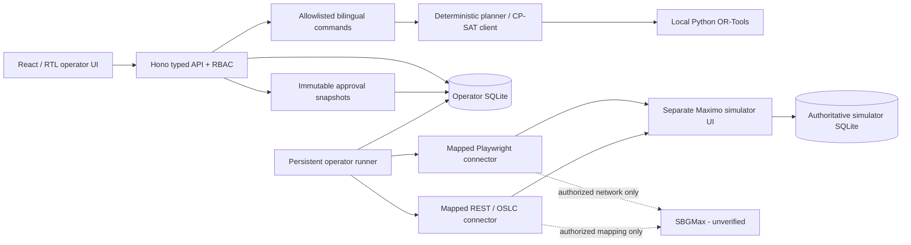

# Architecture

## Monorepo

- `apps/web`: React/TypeScript/Vite, Tailwind, local shadcn-style Radix/variant components. Arabic RTL and English LTR. Real API-backed screens.
- `apps/api`: Hono server, Zod route validation, cookie sessions and typed tool dispatch. No generic field-write or browser-evaluation endpoint.
- `apps/operator-runner`: durable execution loop, leases, reconciliation, stop controls, per-record results.
- `apps/simulator`: independent authoritative store, real login, WO and PM forms, conditional save validation, failure injection through test-only direct database fixtures.
- `packages/domain`: site-aware identities, strict writable field schema, connector contract, plans and changes.
- `packages/scheduler`: deterministic fallback, independent constraint validation and optional CP-SAT client.
- `packages/ai-agent`: bilingual parser or optional enterprise-approved model with Zod tool schema. It never receives maintenance document instructions or permission to approve.
- `packages/approvals`: subset selection, exact snapshot hashing, expiry and cancellation.
- `packages/audit`: nested secret redaction and SHA-256 hash-chain events.
- `packages/maximo-adapters`: two independent connectors behind `MaximoConnector`.
- `packages/shared`: configuration, SQLite abstraction, authorization and repeatable fictitious seed data.

Migrations include all requested relational entities. External records retain typed identity, project, status, revision and synchronization time as indexed columns, plus normalized connector data in JSON for version-specific field flexibility. Scheduling items, approval scopes and audit payloads use JSON snapshots while their references and lifecycle state remain relational. SQLite is accessed through Node's standard library (`DatabaseSync`), not Drizzle. SQL/migrations avoid vendor-specific extensions except local WAL/lease transactions; Cloudflare D1 would require replacing this synchronous database abstraction and moving runner polling to a network job protocol.

## Data flow and invariants

Read-only synchronization preserves authoritative revisions and validates project-to-site mappings. Operator color labels are separate confirmed metadata, never extracted from UI row colors. A plan changes only supported WO scheduling fields. PM due-date proposals use an explicit distinct endpoint and require known simulated generation behavior.

Draft adjustments are validated before persistence. Submission freezes changes; approval stores an exact subset and hash, approver, timestamp and expiration. There is one job per approval. Every step must equal the approved snapshot. The runner rechecks flags and current RBAC, reads external identity/revision/values, obtains fresh WO reservations and labor, and independently validates scheduling before each save. It saves through the connector, re-reads, compares exact values and persists a result. No status implies verification merely because a Save button was clicked.

Jobs use atomic database leases with heartbeats. A process interruption leaves the durable step `RUNNING`; after lease expiry the next runner checks persisted values before attempting any conditional update. Ambiguous network outcomes are reconciled first. Failure to read back is `UNCERTAIN` and stops the batch. A failure on one record may yield `PARTIAL` while other safe records proceed. Emergency stop cannot undo a request already submitted; it prevents subsequent submissions and preserves read-back for the in-flight operation.

No live integration success is inferred from simulation results. Live browser writes lack a proven deployment-specific compare-and-save primitive and are deliberately blocked. Live REST write enablement requires administrator test evidence and strong ETags as well as production flags and exact approval.

A connection-level execution lease serializes independently approved batches from this operator. Lease ownership is rechecked immediately before save. The simulator also rejects overlapping labor intervals within its atomic authoritative save transaction. These controls cannot reserve capacity against an unrelated external enterprise scheduler; deployment-specific Maximo concurrency controls still require validation.

Optional mapped `earliestStart` / `latestFinish` fields are hard record windows. `targetFinish` is a soft due-date objective (falling back to `due`); `targetStart` is retained for inspection. Default duration estimates are not substituted for available approved durations when job-plan precedence is enabled.
